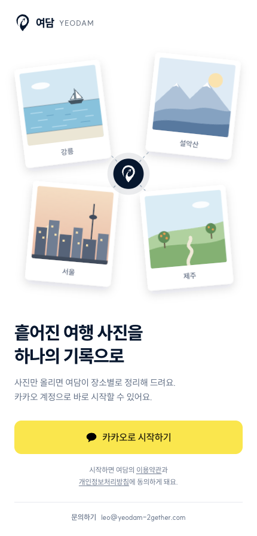
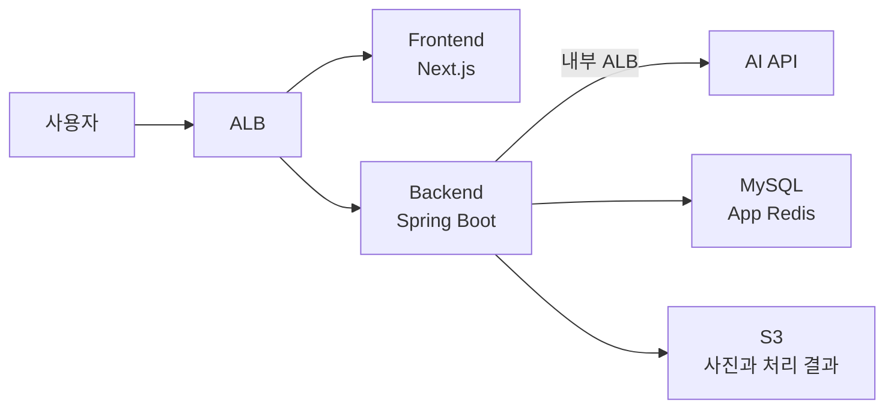

# 여담 Cloud


**흩어진 여행 사진을 하나의 기록으로**

[서비스 바로가기](https://yeodam-2gether.com) / [Cloud Wiki](https://github.com/100-hours-a-week/KTB4-2nd-Cloud/wiki) / [Frontend](https://github.com/100-hours-a-week/KTB4-2nd-FE) / [Backend](https://github.com/100-hours-a-week/KTB4-2nd-BE) / [AI](https://github.com/100-hours-a-week/KTB4-2nd-AI)



## 어떤 서비스인가요?

여담은 **휴대폰과 디지털카메라를 함께 사용하는 여행자를 위한 사진 정리 서비스**입니다.

기기별로 흩어진 사진을 모으고, 촬영 장소를 다시 찾아 분류하는 수고를 줄여 여행을 하나의 기록으로 남길 수 있도록 만들었습니다.

### 주요 기능

- **여행 사진 모으기** — 여러 기기로 찍은 사진을 한 여행에 함께 업로드
- **촬영 위치 복원** — 촬영 시각과 위치 정보를 단서로 GPS가 없는 사진의 장소 추정
- **앨범과 지도** — 사진을 장소별로 묶어 보고 여행 기록을 지도에서 확인
- **여행 스토리** — 사진을 바탕으로 여행 이야기를 생성하고 기록

이 저장소는 여담의 AWS 인프라와 배포, 관측 환경을 관리합니다.

<br clear="all" />

## 서비스 구조

FE, BE, AI API는 ECS Fargate에서 실행합니다. 아래는 운영 중인 V2의 주요 요청 경로입니다.



| 구분 | 구성 |
| --- | --- |
| 데이터와 인증 | MySQL에 서비스 데이터 저장, App Redis에 세션과 CSRF 관리 |
| AI 실행 | GPU EC2의 임베딩 vLLM과 Qdrant, 외부 RunPod의 VLM 사용 |
| 비동기 처리 | Debezium과 Kafka Connect로 Outbox 이벤트 전달. AI 작업 상태는 별도 AI Redis 사용 |
| 배포와 관측 | Terraform, GitHub Actions, Prometheus, Loki, Grafana, CloudWatch |

V3는 운영 V2와 분리된 EKS 환경을 구축 중입니다.

## 배포

```text
FE / BE / AI main → 이미지 발행 → Cloud Manifest PR
→ 이미지 조합 검증 → 스테이징 배포 → 승인한 조합을 운영에 배포
```

이미지는 Digest로 고정합니다. 운영 배포는 성공한 스테이징 Run을 지정해 실행합니다.

[배포 안내](deploy/release-deployment.md) / [이미지 Manifest](deploy/v2/image-manifest.json) / [CI 검증 범위](deploy/cloud-pr-gate.md)

## 개발 기록

- [DB 마이그레이션](https://github.com/100-hours-a-week/KTB4-2nd-Cloud/wiki/Dev-DB-무중단-마이그레이션) — 요청 보존, 인증 동기화와 처리 지연 개선
- [Nginx 연결 고갈](https://github.com/100-hours-a-week/KTB4-2nd-Cloud/wiki/Incident-2026-09-29-Nginx-연결-고갈) — 접속 실패 원인과 방어 과정
- [단일 / 다중 Task 부하 비교](https://github.com/100-hours-a-week/KTB4-2nd-Cloud/pull/475) — 동일 조건에서 요청 분산과 병목 확인

## 저장소 안내

| 경로 | 내용 |
| --- | --- |
| [`terraform/v2/`](terraform/v2/) | 운영과 스테이징 인프라 |
| [`terraform/v3/`](terraform/v3/) | Kubernetes 기반 구축 |
| [`deploy/`](deploy/) | 배포 설정과 이미지 Manifest |
| [`monitoring/`](monitoring/) | 지표, 로그, 대시보드와 알림 |
| [`scripts/`](scripts/) | 배포와 점검 도구 |
| [`tests/`](tests/) | CI 검증과 부하 시험 |

V1 설정과 종료한 이전 시험 도구는 이력으로 보존하고 있습니다.
